# OSPF Underlay with Site-to-Site IPsec VPN Overlay

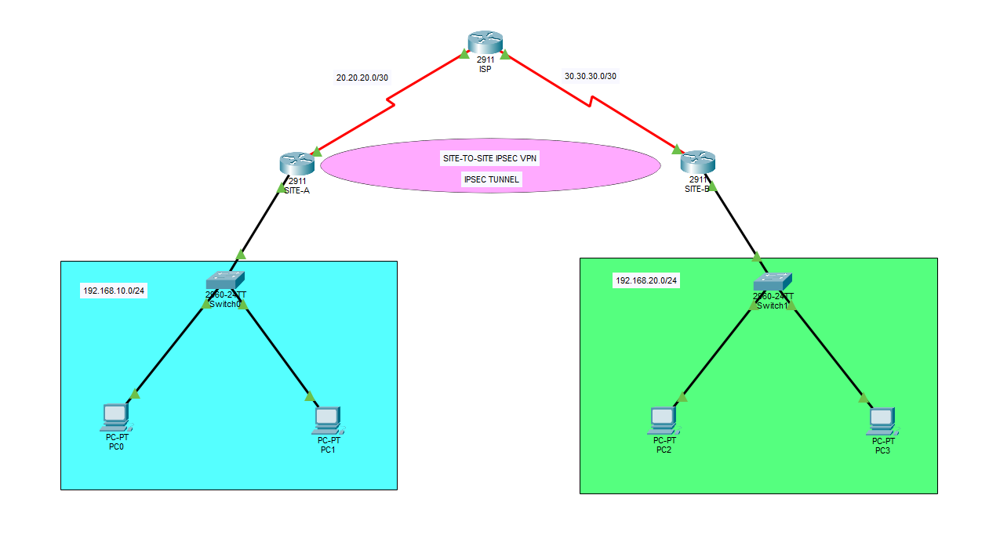

## Project overview

This Cisco Packet Tracer lab connects two private sites across a simulated ISP. OSPF provides underlay route exchange, while a policy-based IPsec VPN encrypts traffic between the two private LANs.

The tunnel is built with IKEv1, pre-shared-key authentication, AES-256 for IKE Phase 1, ESP-AES with SHA-HMAC for Phase 2, mirrored crypto ACLs, and crypto maps applied to the WAN serial interfaces.

The project verifies the complete control and data planes:

- OSPF neighbor formation through the ISP
- Passive LAN interfaces
- IKE Phase 1 in `QM_IDLE`
- Active inbound and outbound ESP Security Associations
- Matching SPI values between peers
- Increasing encryption and decryption counters
- Bidirectional client communication across the VPN
- On-demand tunnel establishment triggered by interesting traffic

> The pre-shared key shown in the downloadable Packet Tracer lab is lab-only. It is replaced with `<REDACTED>` in the published text configurations.

## Skills demonstrated

- Site-to-site policy-based IPsec VPN
- IKEv1 Phase 1 configuration
- IPsec Phase 2 transform sets
- Pre-shared-key peer authentication
- Mirrored encryption domains
- Crypto maps and WAN-interface application
- ESP tunnel mode
- OSPF single-area underlay routing
- Passive OSPF LAN interfaces
- Security Association and SPI analysis
- Encapsulation/decapsulation counter correlation
- End-to-end VPN verification and troubleshooting

## Topology and addressing

| Device | Interface/role | Address | Purpose |
|---|---|---|---|
| SITE-A | LAN | `192.168.10.1/24` | Site A default gateway |
| SITE-A | WAN | `20.20.20.2/30` | VPN endpoint |
| ISP | Toward Site A | `20.20.20.1/30` | Underlay routing |
| ISP | Toward Site B | `30.30.30.1/30` | Underlay routing |
| SITE-B | WAN | `30.30.30.2/30` | VPN endpoint |
| SITE-B | LAN | `192.168.20.1/24` | Site B default gateway |

### Protected networks

```text
Site A: 192.168.10.0/24
Site B: 192.168.20.0/24
```

### VPN endpoints

```text
Site A peer address: 20.20.20.2
Site B peer address: 30.30.30.2
```

The public-looking addresses are used only inside this isolated educational environment. Documentation ranges such as `198.51.100.0/24` and `203.0.113.0/24` would be preferable in production documentation.

## Routing design

OSPF Area 0 forms the underlay:

```text
SITE-A ← OSPF → ISP ← OSPF → SITE-B
```

The ISP provides routed reachability between the public VPN endpoints. The LAN interfaces are passive, so the private networks are advertised without sending OSPF Hello packets toward end hosts.

This is an educational OSPF underlay design. A production ISP would normally not participate in a customer's internal OSPF domain or require private customer routes.

## SITE-A configuration

```cisco
hostname SITE-A

license boot module c2900 technology-package securityk9

crypto isakmp policy 10
 encr aes 256
 hash sha
 authentication pre-share
 group 5
 lifetime 86400

crypto isakmp key <REDACTED> address 30.30.30.2

crypto ipsec transform-set VPN-SET esp-aes esp-sha-hmac

crypto map VPN-MAP 10 ipsec-isakmp
 description THIS VPN CONNECTS TO SITE-B
 set peer 30.30.30.2
 set transform-set VPN-SET
 match address 130

interface GigabitEthernet0/1
 description SITE-A-LAN
 ip address 192.168.10.1 255.255.255.0
 no shutdown

interface Serial0/0/1
 description WAN-TO-ISP
 ip address 20.20.20.2 255.255.255.252
 crypto map VPN-MAP
 no shutdown

router ospf 1
 router-id 1.1.1.1
 passive-interface GigabitEthernet0/1
 network 192.168.10.0 0.0.0.255 area 0
 network 20.20.20.0 0.0.0.3 area 0

access-list 130 permit ip 192.168.10.0 0.0.0.255 192.168.20.0 0.0.0.255
```

## SITE-B configuration

```cisco
hostname SITE-B

license boot module c2900 technology-package securityk9

crypto isakmp policy 10
 encr aes 256
 hash sha
 authentication pre-share
 group 5
 lifetime 86400

crypto isakmp key <REDACTED> address 20.20.20.2

crypto ipsec transform-set VPN-SET esp-aes esp-sha-hmac

crypto map VPN-MAP 10 ipsec-isakmp
 description THIS VPN CONNECTS TO SITE-A
 set peer 20.20.20.2
 set transform-set VPN-SET
 match address 130

interface GigabitEthernet0/1
 description SITE-B-LAN
 ip address 192.168.20.1 255.255.255.0
 no shutdown

interface Serial0/0/0
 description WAN-TO-ISP
 ip address 30.30.30.2 255.255.255.252
 crypto map VPN-MAP
 no shutdown

router ospf 1
 router-id 2.2.2.2
 passive-interface GigabitEthernet0/1
 network 192.168.20.0 0.0.0.255 area 0
 network 30.30.30.0 0.0.0.3 area 0

access-list 130 permit ip 192.168.20.0 0.0.0.255 192.168.10.0 0.0.0.255
```

## ISP configuration

```cisco
hostname ISP

interface Serial0/0/0
 description TO-SITE-B
 ip address 30.30.30.1 255.255.255.252
 no shutdown

interface Serial0/0/1
 description TO-SITE-A
 ip address 20.20.20.1 255.255.255.252
 no shutdown

router ospf 1
 router-id 3.3.3.3
 network 20.20.20.0 0.0.0.3 area 0
 network 30.30.30.0 0.0.0.3 area 0
```

## VPN negotiation flow

1. A Site A client sends traffic to `192.168.20.0/24`.
2. SITE-A routes the packet toward its WAN interface.
3. Crypto ACL 130 identifies the flow as interesting traffic.
4. SITE-A starts IKEv1 negotiation with `30.30.30.2`.
5. The peers authenticate with the pre-shared key.
6. IPsec Phase 2 creates inbound and outbound ESP SAs.
7. The original private packet is encrypted and encapsulated.
8. The ISP routes the outer packet between the public endpoints.
9. SITE-B decrypts it and forwards the original packet to its LAN.
10. Reverse traffic uses the complementary ESP SA.

## Verification evidence

### Site A to Site B client connectivity

Site A clients successfully reached multiple Site B clients. The first protected packet may trigger ARP and VPN negotiation; subsequent packets succeed.


### Site B to Site A client connectivity

Site B clients successfully reached multiple Site A clients, proving bidirectional protected connectivity.

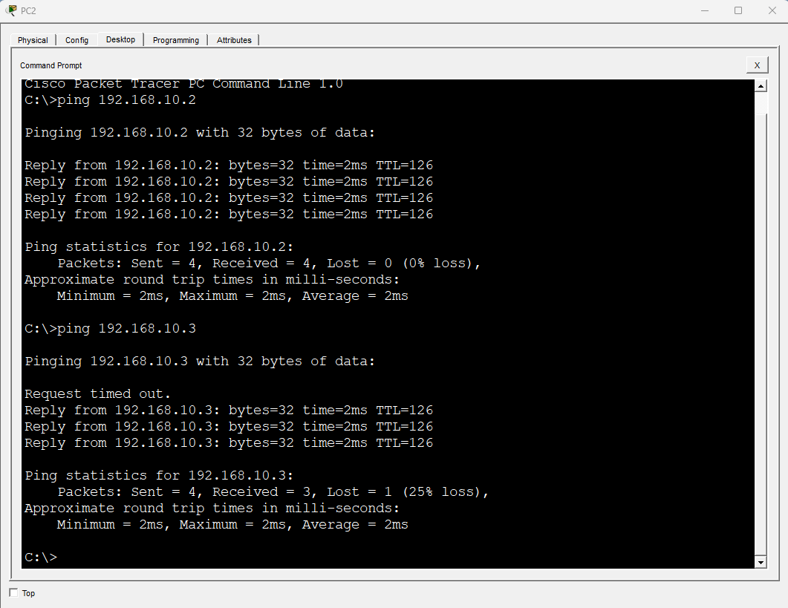

### SITE-A IKE Phase 1

SITE-A reports the peer in `QM_IDLE` with an active IKEv1 Security Association.

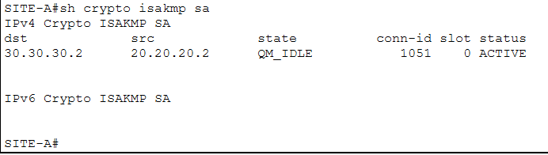

### SITE-B IKE Phase 1

SITE-B reports the reciprocal peer in `QM_IDLE` with an active IKEv1 Security Association.

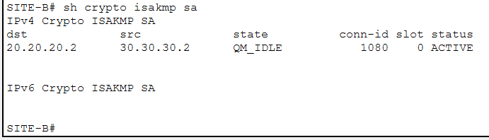

### SITE-A IPsec Security Associations

SITE-A shows active inbound and outbound ESP SAs with increasing encapsulation, encryption, decapsulation, and decryption counters.

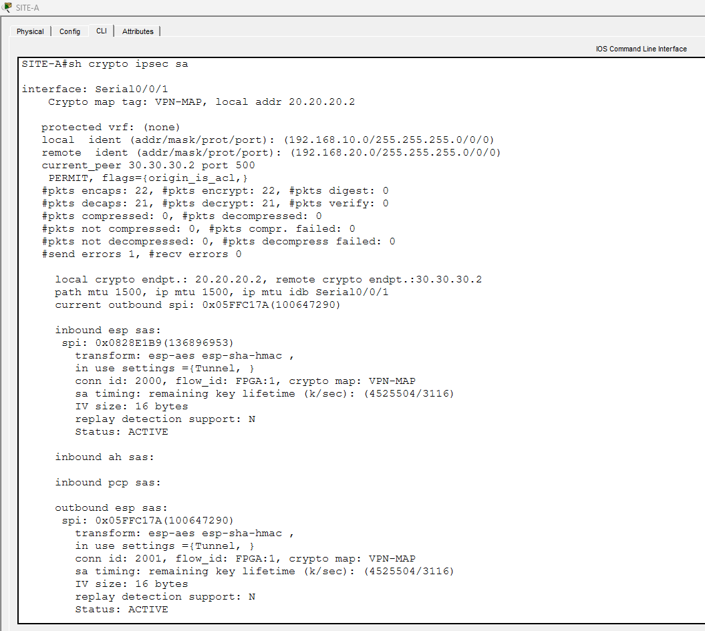

### SITE-B IPsec Security Associations

SITE-B shows matching active ESP SAs and complementary counters.

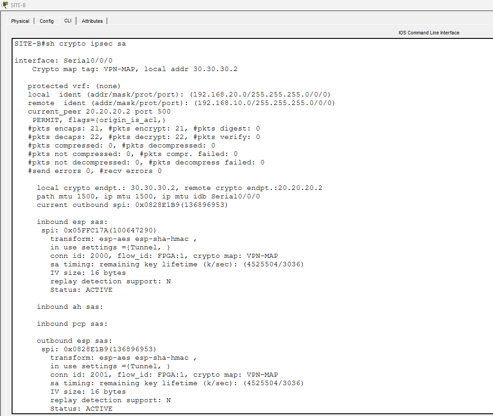

### Packet-counter correlation

| Direction | Encrypted by | Packets | Decrypted by | Packets |
|---|---|---:|---|---:|
| Site A → Site B | SITE-A | 22 | SITE-B | 22 |
| Site B → Site A | SITE-B | 21 | SITE-A | 21 |

### SPI correlation

| Security Association | Outbound SPI | Matching inbound SPI |
|---|---|---|
| Site A → Site B | `0x05FFC17A` on SITE-A | `0x05FFC17A` on SITE-B |
| Site B → Site A | `0x0828E1B9` on SITE-B | `0x0828E1B9` on SITE-A |

The matching SPI values prove that each outbound SA has the expected inbound counterpart on the remote peer.

## OSPF verification

### SITE-A OSPF protocol state

SITE-A advertises its LAN and WAN networks. `GigabitEthernet0/1` is passive.

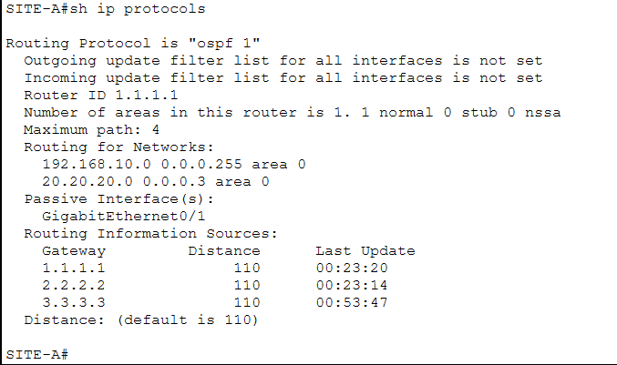

### SITE-A OSPF interfaces

The LAN participates passively while the serial WAN interface carries the active OSPF adjacency.

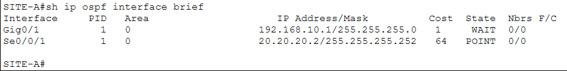

### SITE-A OSPF neighbor

SITE-A forms one full adjacency with the ISP router ID `3.3.3.3`.

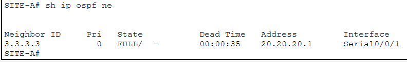

### SITE-B OSPF protocol state

SITE-B advertises its LAN and WAN networks. `GigabitEthernet0/1` is passive.

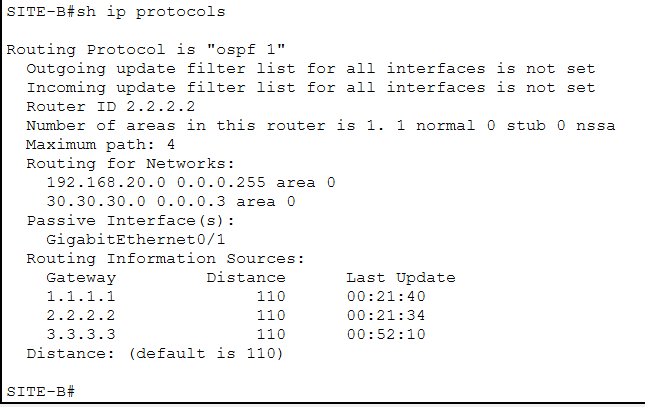

### SITE-B OSPF interfaces

The LAN participates passively while the serial WAN interface carries the active OSPF adjacency.

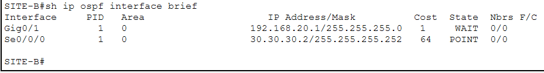

### SITE-B OSPF neighbor

SITE-B forms one full adjacency with the ISP router ID `3.3.3.3`.

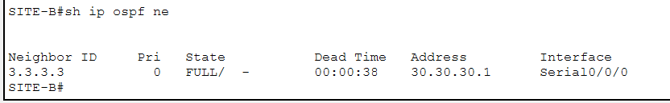

## Before-and-after IPsec behavior

Before interesting traffic is generated:

```text
#pkts encaps: 0
#pkts encrypt: 0
#pkts decaps: 0
#pkts decrypt: 0
current outbound spi: 0x0
No active inbound or outbound ESP SAs
```

After LAN-to-LAN traffic triggers the tunnel:

```text
IKE state: QM_IDLE
Inbound ESP SA: ACTIVE
Outbound ESP SA: ACTIVE
Encapsulation and encryption counters increase
Decapsulation and decryption counters increase
```

This demonstrates that the policy-based tunnel is established on demand.

## Troubleshooting and observations

### First-packet loss

One initial ICMP packet timed out during testing. This is expected while ARP resolution and IKE/IPsec negotiation occur. Repeated traffic succeeds after the SAs become active.

### SITE-A send error

SITE-A displayed one send error after initial negotiation. The counter remained isolated while bidirectional encrypted traffic succeeded. This is consistent with an initial packet being lost during tunnel establishment.

### Phase 1 and Phase 2 algorithms

IKE Phase 1 uses AES-256. The `esp-aes` Phase 2 transform uses the IOS default AES key size for that command. Phase 1 and Phase 2 do not need to use the same AES key size, but both peers must match within each phase.

### Packet Tracer scope

This is an educational simulation. Modern production deployments would normally use stronger current proposals, protected key handling, documentation address ranges, and routing separation appropriate to the provider design.

## Final result

The lab successfully demonstrates an OSPF-routed underlay and an on-demand, bidirectional site-to-site IPsec overlay. Both peers authenticate, negotiate matching SAs, encrypt and decrypt protected traffic, and maintain full client connectivity between `192.168.10.0/24` and `192.168.20.0/24`.
